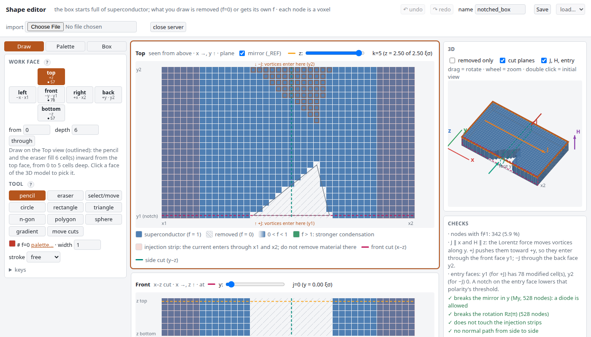
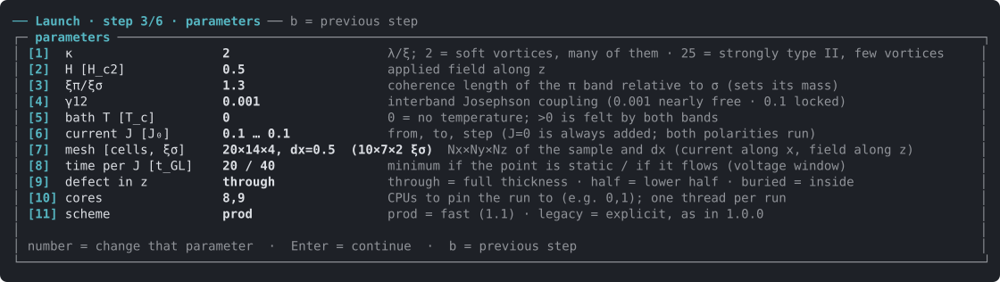
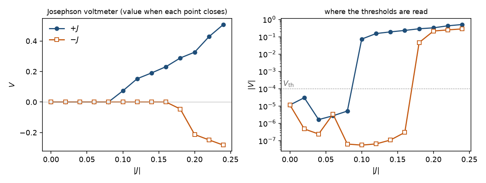
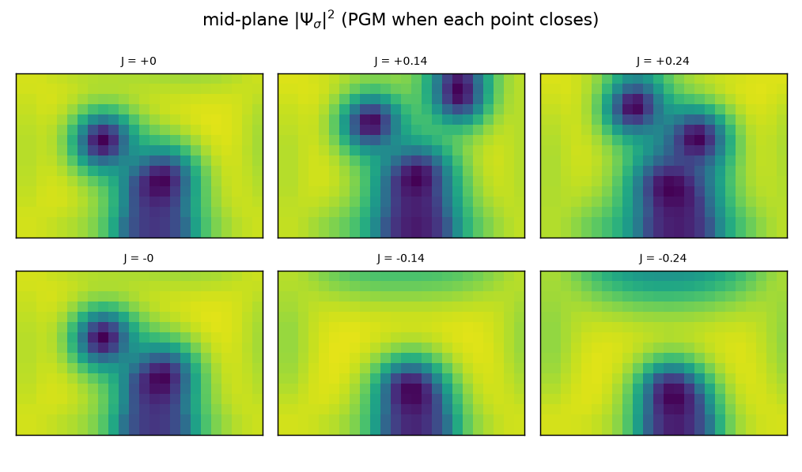

# juliaTDGL

[](LICENSE)

A three-dimensional, two-band time-dependent Ginzburg–Landau (TDGL) solver in Julia for mesoscopic
superconductors under applied field and transport current. It was written to study the geometric
superconducting diode effect in two-gap materials (MgB₂ as the motivating case): a sample whose shape
breaks the mirror symmetry along the direction of vortex motion carries different critical currents
in the two directions.

In the repository: the solver (`julia/`), a terminal menu that launches and follows runs, a browser
editor for three-dimensional shapes, a guide to the physics and the numerics
([`docs/solver_guide.pdf`](docs/solver_guide.pdf)), and a test suite.



**Author:** Jorge Alfredo Robles Calderón — Departamento de Física, Universidad Nacional de Colombia,
Bogotá.

## What it solves

Two order parameters Ψσ, Ψπ coupled by a Josephson term, and the vector potential **A**, on a
rectangular box surrounded by a buffer of a few cells (lengths in ξσ, time in t_GL, fields in H_c2,
currents in J₀). In the buffer the supercurrent vanishes and ∂tA = −κ²∇×∇×A, so it behaves as a
normal metal of unit conductivity, not as vacuum; its width is a parameter of the model:

```
∂t Ψσ = (∇ − iA)² Ψσ + (f − |Ψσ|²) Ψσ + γ12 Ψπ
∂t Ψπ = (1/Γr) [ (1/mr)(∇ − iA)² Ψπ + (f a2n − |Ψπ|²) Ψπ + γ12 Ψσ ]
∂t A  = Js − κ² ∇×∇×A,     Js = Im[Ψσ*(∇ − iA)Ψσ] + (1/mr) Im[Ψπ*(∇ − iA)Ψπ]
```

- **Geometry.** The sample is always the box; `f(r)` (between 0 and 1, or above 1 for locally
  stronger condensation) sets the local condensation strength. Notches, holes and graded regions are regions of
  reduced `f`. A catalogue of shapes is built in, and any shape can be read from a TOML file or drawn
  in a browser editor (`julia/editor/`).
- **Two bands.** `a2n` is the equilibrium density of the π band, `mr` its mass ratio (set from the
  requested ξπ/ξσ), `γ12` the interband coupling, `Γr` the ratio of the π to the σ relaxation time.
- **Field and current.** The applied field enters as a boundary condition on the curl of **A**. The
  transport current enters through its own Ampère field on the faces parallel to it, which is odd in
  the current by construction.
- **Scalar potential (optional).** `use_phi` adds the scalar potential by a Coulomb projection of
  the vector-potential update, with an optional Thomas–Fermi screening length and a relaxing charge
  residual. With it off the scheme runs in the gauge Φ = 0.

Optional terms, all off by default and meant to be switched on one at a time:

| flag | adds |
|---|---|
| `use_drag`, `nu_drag` | mixed-gradient (drag) coupling ν Re[(DΨσ)*·(DΨπ)] in both bands and in the supercurrent |
| `use_heat` | a temperature field θ(r,t) with diffusion and a bath; α_σ = (1−θ)f, α_π = (a2n−θ)f |
| `use_joule` | the normal-current Joule term \|E\|² in the heat source |
| `heat_margin` | leaves out the current-conversion layer next to the injection faces from the heat source |
| `use_Qss` | diffusion of the projection residual |
| `T_physical` | a uniform bath temperature `T_red` felt by both bands |

## How it solves it

- **Discretisation.** Staggered Cartesian mesh with gauge-invariant link variables
  U = exp(−i A·dl): gauge invariance holds exactly on the lattice, and the flux through each
  plaquette is the lattice curl of the link phases.
- **Time stepping.** Two schemes, chosen in one word:
  - `Config(:prod)`, recommended for new work: the curl-curl term of the field equation implicit
    (one separable solve per step), the π band in substeps, and the step at half the stability
    bound of σ. It gives the onset brackets of the explicit scheme and its flowing voltages within
    0.2 %, about 3 times faster per unit time at κ = 2 and about 100 times at κ = 25. With heat, a
    bath temperature or drag the π band runs without substeps and only the curl-curl term is
    implicit: about 30 times faster at κ = 25, validated against the explicit heat and drag runs.
    The scalar potential is not available in it.
  - `Config(:legacy)`, the library default: explicit, with the step set by the most restrictive of
    the diffusion branches of both bands and the Maxwell branch (∝ dx²/κ²). It is the scheme of
    release 1.0.0 and of the published runs, and existing scripts reproduce them unchanged.

  The order-parameter update is a Jacobi sweep over interior nodes; Neumann conditions are imposed
  on every face of the sample.
- **Scalar potential.** The projection solves one Poisson problem per step on a constant matrix,
  diagonalised once by separation of variables (an exact direct method, no iteration).
- **Voltage.** The voltage is the time derivative of the gauge-invariant phase difference between
  two measuring planes, unwrapped line by line (the Josephson relation). Each 2π slip of a line is a
  vortex crossing, so the number of crossings in the averaging window is reported with every
  voltage.
- **Convergence.** Each current point runs for a minimum physical time and closes either as a fixed
  point (Meissner or pinned vortices) or as a stationary limit cycle (flux flow); the class is
  reported with the result. Current ladders are seeded point by point, so a point depends on the
  path that reached it.
- **Numerical modes.** `Strict` (default) takes `hypot` and `sincos` from the C maths library, so a
  run gives the same digits for any number of threads and is the mode of the regression tests;
  `Fast` uses Julia's native functions, vectorises, is about 1.3 times faster and agrees to machine
  precision.

A longer description of the physics and the numerics, where runs are written and how to run on a
cluster, is in [`docs/solver_guide.pdf`](docs/solver_guide.pdf).

## Install

The code is a Julia project, not a registered package: clone it and instantiate it once. The
exact versions of every dependency are pinned in `julia/Manifest.toml`.

1. Julia 1.10 or later. On Linux and macOS, `curl -fsSL https://install.julialang.org | sh`
   installs `juliaup`; on Windows, follow
   [julialang.org/downloads](https://julialang.org/downloads/).
2. Clone and instantiate:

   ```bash
   git clone https://github.com/georgeotjg/juliaTDGL.git
   cd juliaTDGL
   julia --project=julia -e 'using Pkg; Pkg.instantiate()'
   ```

3. Check the installation (about two minutes):

   ```bash
   julia --project=julia julia/test/run.jl
   ```

Optional: Python 3.10 or later for the terminal menu and the shape editor (standard library
only), and matplotlib for the run figures.

## A first run

About a minute on a laptop: a small notched box, both polarities, short windows
(`julia --project=julia examples/first_run.jl` runs the same).

```julia
using Pkg; Pkg.activate("julia")
using TDGL
sde = run_case(Config(GEOM_MODE="WEDGE", Nx_sc=24, Ny_sc=16, Nz_sc=4, dx=0.5, dy=0.5, dz=0.5,
                      kappa_s=2.0, kappa_p=2.0, xi_ratio=1.3, H_const=0.5,
                      J_list=[0.05, 0.15], t_min_GL=100.0, t_min_GL_res=150.0,
                      out_dir="runs/first", run_tag="first"))
sde.pos.V_arr, sde.neg.V_arr      # at |J| = 0.15: V(+J) ≈ 0.20, V(−J) ≈ 1e-4 — the notch rectifies
```

The run ends with a summary (also written to `runs/first/output/RUN_SUMMARY_*.txt`). Each critical
current is given as a bracket with the verdict rule of the paper: a rung integrated for Δt at
voltage V carries |V|Δt/2π vortex crossings per measuring line; it is silent below one,
dissipating at ten or more, and undecided in between, to be re-measured on a doubled window. η is
given at the bracket centres with its range, and σ_V = (|V₊| − |V₋|)/(|V₊| + |V₋|) where both
polarities dissipate. Here the windows are far too short and +0.15 is undecided, so no η is
formed. A simpler threshold estimate (where |V| first exceeds V_th) is printed next to it and
withheld when the drive is even in J, when there is no vortex, or when the threshold is already
crossed at the first current of the grid. The protocol of the paper uses windows of 1500/2000 t_GL
(`--window paper` below, or `Config(:paper)`). The same keywords in `Config(:prod; ...)` run the
production scheme.

From the command line, one run per call (writes `julia/runs/<name>/` with `job.json`,
`j_history.csv`, snapshots and checkpoints for restarting):

```bash
julia --project=julia julia/scripts/run_preset.jl \
    --geom WEDGE --kappa 2 --mesh production --window paper --J 0.0,0.040,0.045
```

`run_preset.jl` and the terminal menu use the production scheme unless `--scheme legacy` is given.
With Φ they use the explicit scheme; with heat, drag or a bath temperature, the faster of the two
(prod at large κ). A resumed run keeps the scheme it started with.

## Shapes

Any geometry can be drawn in the browser, with nothing to install:
`python3 julia/editor/server.py` opens it. Pick a face of the sample (or click it on the 3D view)
and paint from that face inward, `depth` cells deep and `from` cells inside, so cuts can also be
buried in the sample; figures, f and depth gradients, and a palette of condensation strengths are
there too. The 3D view shows the current, the field and the face through which vortices enter for
each sign of J; the checks say, while you draw, whether the shape can rectify at all (a shape
symmetric under the mirror in y gives η = 0 exactly), whether it touches the injection faces, and
where either band turns normal. Shapes are saved as TOML in `julia/shapes/` and used with
`GEOM_MODE="CUSTOM", geom_file="julia/shapes/<name>.toml"`.


## The terminal menu

`python3 julia/scripts/tdgl_tui.py` launches, stops and resumes runs and lists every Julia run of
the project with its progress. The launch wizard goes through a starting point, the geometry
(catalogue, a saved shape, or a new one drawn in the editor), a parameter table (including the
scheme, `prod` by default), the scalar potential and at most one optional term. Key `v` gives the
result of every run with the verdict rule; key `c` adds or removes folders to watch (runs started
from your own scripts elsewhere show up too); while the menu is open (or with `--watch`) a desktop
notification is sent when a run finishes. `--help` lists the command-line options.



```
│ #   run                 term     state     progress        last J          %CPU │
│ 1   julia/runs/demo     base     ● live    ██████░░ 19/26  J-0.120 V      98.9% │

> v
  demo: Ic+ ∈ (0.08, 0.14)  |Ic−| ∈ (0.16, 0.2)  η = -24.1 % [-42.9, -6.7]
        undecided: +0.1 +0.12 −0.18  σ_V@0.2 = +21.0 %
```

## What a run gives

`python3 julia/scripts/plot_summary.py RUNDIR` draws V(J) for both polarities (linear, and
log|V| against V_th, where the thresholds are read) and the mid-plane |Ψσ|² of every closed
current point. For ParaView, `vtk_from_checkpoint.jl` writes the full state as VTK.

When a run starts from `run_preset.jl` (or the terminal menu), `figures/geometry.png` shows the
mask: the six faces unfolded, the mid plane and how many z planes each column has with f ≠ 1.

To compare shapes before committing hours, `julia/scripts/scout_shapes.jl a.toml b.toml …` runs
each on the production box with short windows and prints a ranking (minutes per shape; a ranking,
not a measurement: the winner then needs the full protocol and its mirror).

Long runs save a checkpoint after every current point and resume from it (`restart_pos`,
`restart_neg`); `guard_hours` stops cleanly before a queue limit, and `keep_rung_states` keeps the
state of every point, not only the last.

The figures below come from a run of about ten minutes: the notched box of the first run, H = 0.5,
J from 0.02 to 0.24 in steps of 0.02, windows of 300/400 t_GL
(`examples/notched_box_demo.jl`). +J leaves the floor at 0.10 and −J at 0.18: vortices enter
through the notch for +J and are expelled for −J. Its summary flags three undecided rungs, so the η it prints, −24 % [−43, −7], is provisional until
those rungs are re-measured on doubled windows.





## Checks against known physics

- **Nucleation fields.** The linearised operator gives the lowest Landau level on a periodic lattice
  within 1.6 % at the production mesh, and the surface-nucleation ratio H_c3/H_c2 within 0.05 % of
  the Saint-James–de Gennes value 1.6946. The static two-band state does not depend on the
  relaxation ratio Γr, as it must not.
- **Gauge invariance.** With the scalar potential on and no relaxation, the step is a lattice gauge
  transformation: |Ψ|, B and the Josephson voltage are those of Φ = 0 to round-off.
- **Symmetry.** A sample symmetric under the mirror along the direction of vortex motion gives zero
  diode efficiency to machine precision, because complex conjugation composed with that mirror maps
  +J onto −J. `check_my_symmetry` reports whether a mask has that symmetry.
- **Depairing.** The uniform-flow depairing current of the two coupled bands is 0.546 J₀ at the
  parameters of the methods paper; a one-dimensional slab with its own field starts to dissipate at
  0.54–0.55 J₀, and the notched box at a mean density of 0.51–0.56 J₀.
- The test suite also checks the kernel against a slow reference loop, every optional term, shapes
  read from files, and regression against stored states (`data/`), so that a change of the code that
  is not meant to change the results does not.

## Layout

```
julia/          solver (src), tests, scripts, terminal menu, shape files and editor
data/           stored states used by the regression tests
docs/           solver_guide.pdf: the model, the numerics, the optional terms and the protocol
examples/       the first run and the demonstration run of this README, and a Slurm job
```

## Known limitations

- **The silent state is driven, not an equilibrium.** The current enters through the contact faces
  as normal current and turns into supercurrent within one or two ξσ. In a state with no vortex
  motion the order parameter is static, but those layers carry a steady electric field and
  dissipate. The current at which such a state starts to flow therefore depends on the relaxation
  rates (`gamma_ratio`) and on the contact, not only on the free energy: in the two-band notched box
  the onset moves from 0.52 to 0.80 J₀ as Γr goes from 0.5 to 2, because the contact layer divides
  the current between the bands differently and the onset comes at a fixed load of one band. Quote
  onsets for the relaxation rates and contact used.
- **The buffer is normal metal and there are no common electrodes.** A buffer of a few cells or more
  carries normal current in parallel with the sample, even when the sample is silent (with 24 cells
  around the production box, 62 % of the current), so a thicker buffer is not a closer model of a
  film in vacuum. One cell, the default, keeps that path small; quote results for the buffer used.
- **The fixed-point tolerance is per cycle** (`eps_conv`), so the same value is a different
  criterion when dt or lMax change. `eps_conv_rate` sets it per unit time, and `:prod` keeps the
  criterion of the explicit scheme in physical time. Neither tells a point
  that sits in the bottleneck of a slow cycle from a fixed point; the crossing-count verdict of the
  protocol does.
- **`STOP.txt` is looked for up to eight folders above the run folder**: one file stops every run
  below it.
- **The step of `:prod` cannot grow much further.** In strong flow the error comes from updating the
  field and the links once per step during a phase slip: at κ = 25 the voltage is 0.16 % off at
  dt = 0.03 and 3 % off at 0.04. Larger steps (`sigma_substeps`) give the same onset verdicts but
  voltages a few per cent off near onset; re-measure the voltages you quote at the production step.
- **The scalar potential runs only in the explicit scheme.** Heat, bath temperature and drag run in
  `:prod` without π substeps, so at κ = 2 they gain nothing over the explicit scheme.
- **Memory:** a few per-cycle series are allocated with `mMax` entries when a sweep starts (40 bytes
  per cycle); keep `mMax` at the ceiling you need, not at an arbitrary large number. A sweep warns
  above 1 GB.
- **Campaigns:** run one single-threaded process per physical core (`:prod` sets one BLAS thread).
  On hybrid processors the efficiency cores are slower, so a campaign is paced by them.

## Planned

Each item is validated against this release before it is used; none of it is in this code yet.
- **An insulating buffer** on the faces parallel to the current, so that all of the current crosses
  the sample, as in a film in vacuum with leads at its ends. It removes the parallel normal path of
  the known limitations and makes the magnitude of a diode efficiency a number that can be compared
  with an experiment.
- **A multiband generalised TDGL** with a band-resolved charge imbalance (Kramer–Watts-Tobin
  generalised to several bands). It would compute what TDGL leaves as free parameters, the
  relaxation rates and how a contact divides the current between the bands, and would let the
  solver ask whether quasiparticles left by one band change vortex entry in another. Two bands
  (MgB₂) first; the data structures for N bands from the start.

## Citing

The solver, the measurement protocol and the failure modes it guards against are described in:

> Robles Calderón, J. A. (2026). *Silent failure modes in three-dimensional two-band time-dependent
> Ginzburg–Landau simulations of geometric superconducting diodes* (Version 1.0.0) [Preprint].
> Zenodo. https://doi.org/10.5281/zenodo.23163207

With its default settings (`Config(:legacy)`), this repository gives the results of that work; the
options added since, including the production scheme, are off by default in the library. `CITATION.cff` has the metadata, and GitHub's "Cite this repository" button reads it.

## License

MIT (see `LICENSE`). The code started from a short one-band TDGL script provided by J. Barba-Ortega
(Universidad Nacional de Colombia).
