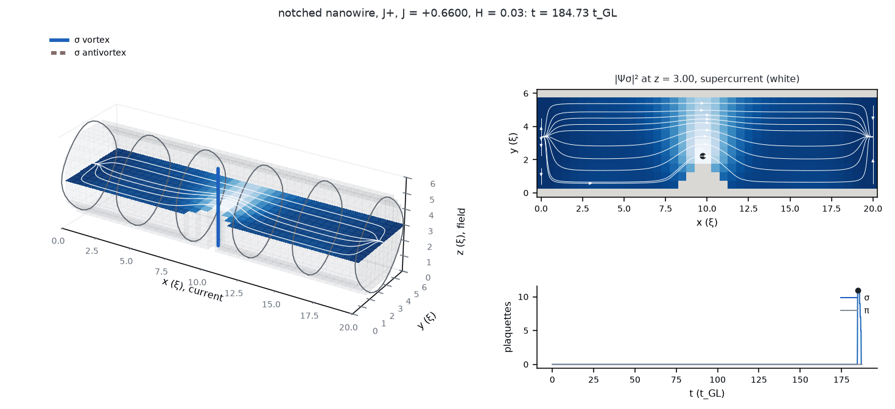
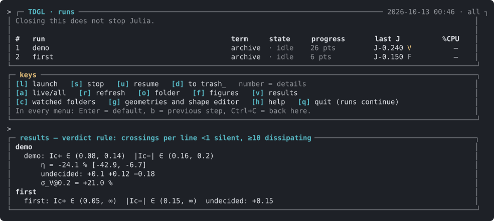

# juliaTDGL

[](LICENSE)

**Documentation:** https://georgeotjg.github.io/juliaTDGL/ (the model, the numerics, the protocol, examples, tools, validation and
every option of a run file).

Three-dimensional time-dependent Ginzburg–Landau (TDGL) solvers in Julia for multiband superconductors
under applied field and transport current, on mesoscopic samples of any shape: N bands coupled by a
Josephson matrix, each with its own stiffness, relaxation rate and Kramer–Watts-Tobin parameter (release 2.0),
and the two-band TDGL of the published work (release 1.2). They were written for the geometric
superconducting diode effect, where a sample whose shape breaks the mirror symmetry along the direction of
vortex motion carries different critical currents in the two directions. Two-gap MgB₂ motivated them; a
material is a file of parameters, so other multiband materials are a new file, not new code.

The repository holds two releases of the same package (`TDGL`):
- **Release 2.0** (`tdgl2/`), recommended for new work: N bands, each with its own Kramer–Watts-Tobin
  relaxation (the charge imbalance at the contacts) and an optional finite interband exchange of quasiparticles,
  anisotropic bands, thermal noise, an open boundary for the self-field, an insulating buffer, a material per region
  (bilayers, with a barrier between them), and the onset by the delay of the first phase slip. Its own README:
  [`tdgl2/README.md`](tdgl2/README.md) (with a table of what each release has and what each option costs); its guide:
  [`docs/solver_guide_2.pdf`](docs/solver_guide_2.pdf).
- **Release 1.2** (`julia/`), the two-band TDGL of the published work (it contains releases 1.0 and 1.1; by default
  the production scheme, `Config(:legacy)` the explicit scheme of 1.0.0), with the scalar potential, a terminal
  menu that launches and follows runs (of both releases), a browser editor for three-dimensional shapes,
  and its guide ([`docs/solver_guide.pdf`](docs/solver_guide.pdf)). The rest of this page describes it.

With its new terms off, 2.0 reproduces 1.2. Release 2.0 is complete in its scope; apart from it, a GPU port is planned. The tag `v2.0.0` follows release 2.0. Both are Julia projects
of the same package, so each runs in its own project (`--project=tdgl2` or `--project=julia`); they are not loaded together.




**Author:** Jorge Alfredo Robles Calderón — Departamento de Física, Universidad Nacional de Colombia,
Bogotá.

**Quick start** (Julia 1.13 or later; everything else is installed by the first command of each release):

```bash
git clone https://github.com/georgeotjg/juliaTDGL.git && cd juliaTDGL
# release 2.0
julia --project=tdgl2 -e 'using Pkg; Pkg.instantiate()'
OPENBLAS_NUM_THREADS=1 julia --project=tdgl2 tdgl2/scripts/run.jl tdgl2/examples/wedge_k25.toml   # minutes
# release 1.2
julia --project=julia -e 'using Pkg; Pkg.instantiate()'
julia --project=julia examples/first_run.jl     # a notched box, both polarities, about a minute
julia julia/scripts/tdgl_tui.jl                 # the terminal menu: launch, follow, stop, resume
```

The first hour with release 2.0, from a run to its figures, a finer onset and a 3D film of the vortex:
[`tdgl2/TUTORIAL.md`](tdgl2/TUTORIAL.md).

## What release 2.0 contains

**The model.** Generalised TDGL for N bands with a symmetric Josephson matrix, in the gauge Φ = 0, coupled to the
magnetic field (Ampère with the normal current):
- Kramer–Watts-Tobin relaxation per band: the charge imbalance at the contacts, in its slaved form.
- Normal fluids per band with a finite interband exchange rate (`qp_exchange`).
- Anisotropic masses, a heat model with Joule heating, the mixed-gradient (drag) term, a bath temperature.
- Thermal Langevin noise on every band and on the field, with fluctuation–dissipation also under KWT.
- Regions of different materials (other ξ, Γ, a, β, KWT, σ_n, a band absent), joined through a barrier of given transparency.
- Samples of any shape: notches and holes by a condensation mask, or a sample carved in vacuum (a nanowire) with an
  insulating buffer.
- Self-field boundaries: the bar of the sample, the open boundary (lattice Green function), or the slab of release 1.x.

**The numerics.**
- Gauge-invariant link variables on a staggered mesh; the curl-curl term implicit, solved exactly by separable bases or by
  preconditioned conjugate gradients with the insulating buffer.
- The bands made stiff by KWT advance by stabilised explicit stages (damped Runge–Kutta–Chebyshev by default; Legendre on
  request) in a rotating frame, so a stationary state with charge imbalance is a fixed point of the step for any dt.
- With noise, the stiff phase modes take the kick inside the stages (SK-ROCK).
- Every run is reproducible to the bit from its folder: stop and resume, two polarities in two processes, the scheme defaults
  the folder started with.

**The measurement.**
- Current ladders with a verdict per point: fixed point, flow, normal, heat cut.
- The onset by the delay of the first phase slip, refined with one command.
- Brackets and diode efficiency, a one-page report per run, figures, and 3D films of the vortex events (VTK, a browser viewer,
  GIF).

**How it is checked** (about 600 tests):
- Against release 1.2 of the published work, to the bit, with the new terms off.
- Against pyTDGL for one band in 2D: the depairing current, the conversion length with KWT (within 0.2 %), and the onset of a
  notched strip.
- Analytic and exact limits: the one-dimensional two-fluid law, the proximity length into another material on the lattice
  (4e-5), the discrete continuity across an interface (1e-15), the discrete energy balance, equipartition of the field modes, and
  the Gibbs equilibrium under noise independent of the mobility.

**Speed** (one laptop core):
- A two-band box of 40 × 24 × 6 cells runs a rung of 1600 t_GL in about two minutes without KWT.
- With KWT and γ̃ = 10 it costs about twice that.
- The insulating buffer costs about three times a metal one (the nanowire box: 4.5 ms per step against 1.5 ms without vacuum).

**What it is not.**
- A Ginzburg–Landau model: valid near T_c and on scales of ξ, not a microscopic (Bogoliubov–de Gennes or Usadel) theory.
- The band-resolved charge imbalance has no memory, and release 2.0 has no scalar potential (release 1.2 keeps it).
- The implicit solve needs dx = dy = dz.
- No GPU yet: the loops are per node and per link, so a port is mechanical.
- The known limits of each option are in `tdgl2/README.md`.

## What it solves

Two order parameters Ψσ, Ψπ coupled by a Josephson term, and the vector potential **A**, on a
rectangular box surrounded by a buffer of a few cells (lengths in ξσ, time in t_GL, fields in H_c2,
currents in J₀). In the buffer the supercurrent vanishes and ∂tA = −κ²∇×∇×A, so it behaves as a
normal metal of unit conductivity, not as vacuum; its width is a parameter of the model:

```
∂t Ψσ = (∇ − iA)² Ψσ + (f − |Ψσ|²) Ψσ + γ12 Ψπ
∂t Ψπ = (1/Γr) [ (1/mr)(∇ − iA)² Ψπ + (f a2n − |Ψπ|²) Ψπ + γ12 Ψσ ]
∂t A  = Js − κ² ∇×∇×A,     Js = Im[Ψσ*(∇ − iA)Ψσ] + (1/mr) Im[Ψπ*(∇ − iA)Ψπ]
```

- **Geometry.** The sample is always the box; `f(r)` (between 0 and 1, or above 1 for locally
  stronger condensation) sets the local condensation strength. Notches, holes and graded regions are regions of
  reduced `f`. A catalogue of shapes is built in, and any shape can be read from a TOML file or drawn
  in a browser editor (`julia/editor/`).
- **Two bands.** `a2n` is the equilibrium density of the π band, `mr` its mass ratio (set from the
  requested ξπ/ξσ), `γ12` the interband coupling, `Γr` the ratio of the π to the σ relaxation time.
- **Field and current.** The applied field enters as a boundary condition on the curl of **A**. The
  transport current enters through its own Ampère field on the faces parallel to it, which is odd in
  the current by construction.
- **Scalar potential (optional).** `use_phi` adds the scalar potential by a Coulomb projection of
  the vector-potential update, with an optional Thomas–Fermi screening length and a relaxing charge
  residual. With it off the scheme runs in the gauge Φ = 0.

Optional terms, all off by default and meant to be switched on one at a time:

| flag | adds |
|---|---|
| `use_drag`, `nu_drag` | mixed-gradient (drag) coupling ν Re[(DΨσ)*·(DΨπ)] in both bands and in the supercurrent |
| `use_heat` | a temperature field θ(r,t) with diffusion and a bath; α_σ = (1−θ)f, α_π = (a2n−θ)f |
| `use_joule` | the normal-current Joule term \|E\|² in the heat source |
| `heat_margin` | leaves out the current-conversion layer next to the injection faces from the heat source |
| `use_Qss` | diffusion of the projection residual |
| `T_physical` | a uniform bath temperature `T_red` felt by both bands |

## How it solves it

- **Discretisation.** Staggered Cartesian mesh with gauge-invariant link variables
  U = exp(−i A·dl): gauge invariance holds exactly on the lattice, and the flux through each
  plaquette is the lattice curl of the link phases.
- **Time stepping.** Two schemes, chosen in one word:
  - the production scheme, the default (`Config(...)`, or `Config(:prod; ...)`): the curl-curl term of the field equation implicit
    (one separable solve per step), the π band in substeps, and the step at half the stability
    bound of σ. It gives the onset brackets of the explicit scheme and its flowing voltages within
    0.2 %, about 3 times faster per unit time at κ = 2 and about 100 times at κ = 25. With heat, a
    bath temperature or drag the π band runs without substeps and only the curl-curl term is
    implicit: about 30 times faster at κ = 25, validated against the explicit heat and drag runs.
    The scalar potential runs in the explicit scheme: a run with `use_phi` switches to it by itself.
  - `Config(:legacy; ...)`: explicit, with the step set by the most restrictive of the diffusion
    branches of both bands and the Maxwell branch (∝ dx²/κ²). It is the scheme of release 1.0.0 and of
    the published runs (the library default up to release 1.2), and the scripts of those runs ask for it.

  The order-parameter update is a Jacobi sweep over interior nodes; Neumann conditions are imposed
  on every face of the sample.
- **Scalar potential.** The projection solves one Poisson problem per step on a constant matrix,
  diagonalised once by separation of variables (an exact direct method, no iteration).
- **Voltage.** The voltage is the time derivative of the gauge-invariant phase difference between
  two measuring planes, unwrapped line by line (the Josephson relation). Each 2π slip of a line is a
  vortex crossing, so the number of crossings in the averaging window is reported with every
  voltage.
- **Convergence.** Each current point runs for a minimum physical time and closes either as a fixed
  point (Meissner or pinned vortices) or as a stationary limit cycle (flux flow); the class is
  reported with the result. Current ladders are seeded point by point, so a point depends on the
  path that reached it.
- **Numerical modes.** `Fast` (default) uses Julia's native functions and vectorises; `Strict`
  (`run_case(cfg; mode=Strict())`) takes `hypot` and `sincos` from the C maths library, is about 1.3 times
  slower and gives the digits of the earlier releases and of the regression tests. The two agree to
  machine precision.

A longer description of the physics and the numerics, where runs are written and how to run on a
cluster, is in [`docs/solver_guide.pdf`](docs/solver_guide.pdf).

## Install

The code is a Julia project, not a registered package: clone it and instantiate it once. The
exact versions of every dependency are pinned in `julia/Manifest.toml`.

1. Julia 1.13 or later (release 1.2 was tested with 1.12 and 1.13). On Linux and macOS, `curl -fsSL https://install.julialang.org | sh`
   installs `juliaup`; on Windows, follow
   [julialang.org/downloads](https://julialang.org/downloads/).
2. Clone and instantiate:

   ```bash
   git clone https://github.com/georgeotjg/juliaTDGL.git
   cd juliaTDGL
   julia --project=julia -e 'using Pkg; Pkg.instantiate()'
   ```

3. Check the installation (about two minutes):

   ```bash
   julia --project=julia julia/test/run.jl
   ```

Everything runs in Julia, the terminal menu and the shape editor included. Optional: Python 3 with
matplotlib, only for the quick run figures (`plot_summary.py`); release 2 adds NumPy for its figures and films, and plotly
(if installed) to carry the 3D film page offline.

## A first run

About a minute on a laptop: a small notched box, both polarities, short windows
(`julia --project=julia examples/first_run.jl` runs the same).

```julia
using Pkg; Pkg.activate("julia")
using TDGL
sde = run_case(Config(GEOM_MODE="WEDGE", Nx_sc=24, Ny_sc=16, Nz_sc=4, dx=0.5, dy=0.5, dz=0.5,
                      kappa_s=2.0, kappa_p=2.0, xi_ratio=1.3, H_const=0.5,
                      J_list=[0.05, 0.15], t_min_GL=100.0, t_min_GL_res=150.0,
                      out_dir="runs/first", run_tag="first"))
sde.pos.V_arr, sde.neg.V_arr      # at |J| = 0.15: V(+J) ≈ 0.20, V(−J) ≈ 1e-4 — the notch rectifies
```

The run ends with a summary (also written to `runs/first/output/RUN_SUMMARY_*.txt`). Each critical
current is given as a bracket with the verdict rule of the paper: a rung integrated for Δt at
voltage V carries |V|Δt/2π vortex crossings per measuring line; it is silent below one,
dissipating at ten or more, and undecided in between, to be re-measured on a doubled window. η is
given at the bracket centres with its range, and σ_V = (|V₊| − |V₋|)/(|V₊| + |V₋|) where both
polarities dissipate. Here the windows are far too short and +0.15 is undecided, so no η is
formed. A simpler threshold estimate (where |V| first exceeds V_th) is printed next to it and
withheld when the drive is even in J, when there is no vortex, or when the threshold is already
crossed at the first current of the grid. The protocol of the paper uses windows of 1500/2000 t_GL
(`--window paper` below, or `Config(:paper)`). The same keywords in `Config(:legacy; ...)` run the
explicit scheme of release 1.0.0.

From the command line, one run per call (writes `julia/runs/<name>/` with `job.json`,
`j_history.csv`, snapshots and checkpoints for restarting):

```bash
julia --project=julia julia/scripts/run_preset.jl \
    --geom WEDGE --kappa 2 --mesh production --window paper --J 0.0,0.040,0.045
```

`run_preset.jl` and the terminal menu use the production scheme unless `--scheme legacy` is given.
With Φ they use the explicit scheme; with heat, drag or a bath temperature, the faster of the two
(prod at large κ). A resumed run keeps the scheme it started with.

## Shapes

Any geometry can be drawn in the browser, with nothing to install:
`julia julia/editor/server.jl` opens it. Pick a face of the sample (or click it on the 3D view)
and paint from that face inward, `depth` cells deep and `from` cells inside, so cuts can also be
buried in the sample. Figures (circle, rectangle, polygon, …) are drawn on any of the three views and go
through the sample along that view's axis; a figure can be kept with the rest removed (a cable), and what is
removed can be a normal metal (f = 0) or vacuum (no material: release 2, a sculpted sample with leads of its own
section). f and depth gradients and a palette of condensation strengths are there too. The 3D view shows the current, the field and the face through which vortices enter for
each sign of J; the checks say, while you draw, whether the shape can rectify at all (a shape
symmetric under the mirror in y gives η = 0 exactly), whether it touches the injection faces, and
where either band turns normal. Shapes are saved as TOML in `julia/shapes/` and used with
`GEOM_MODE="CUSTOM", geom_file="julia/shapes/<name>.toml"`.


## The terminal menu

`julia julia/scripts/tdgl_tui.jl` launches, stops and resumes runs and lists every Julia run of
the project with its progress. The launch wizard goes through a starting point, the geometry
(catalogue, a saved shape, or a new one drawn in the editor), a parameter table (including the
scheme, `prod` by default), the scalar potential and at most one optional term. Key `n` launches a run of
release 2.0 from a TOML file (one of `tdgl2/examples/` or any path), the wizard ends with the choice of release (`2`
launches the same run with release 2.0), and the runs of 2.0 are listed, stopped and resumed with the others. Key `v` gives the
result of every run with the verdict rule; key `c` adds or removes folders to watch (runs started
from your own scripts elsewhere show up too); while the menu is open (or with `--watch`) a desktop
notification is sent when a run finishes. `--help` lists the command-line options. The menu and the
editor server are a small package of their own (`julia/tui/`, standard library only, Julia 1.11 or
later); the first start compiles it once, later ones take a fraction of a second. To have it as a
command anywhere (Julia 1.12 or later, Pkg apps):

```bash
julia -e 'using Pkg; Pkg.Apps.develop(path="julia/tui")'   # installs ~/.julia/bin/tdgl-tui
tdgl-tui            # the menu;  tdgl-tui --editor  the shape editor;  tdgl-tui --help
```

`~/.julia/bin` must be on the `PATH`. After updating Julia, `Pkg.Apps.update()` refreshes the command.




## What a run gives

`python3 julia/scripts/plot_summary.py RUNDIR` (optional: Python 3 with matplotlib) draws V(J) for both polarities (linear, and
log|V| against V_th, where the thresholds are read) and the mid-plane |Ψσ|² of every closed
current point. For ParaView, `vtk_from_checkpoint.jl` writes the full state as VTK.

When a run starts from `run_preset.jl` (or the terminal menu), `figures/geometry.png` shows the
mask: the six faces unfolded, the mid plane and how many z planes each column has with f ≠ 1.

To compare shapes before committing hours, `julia/scripts/scout_shapes.jl a.toml b.toml …` runs
each on the production box with short windows and prints a ranking (minutes per shape; a ranking,
not a measurement: the winner then needs the full protocol and its mirror).

Long runs save a checkpoint after every current point (`restart/state_J*.jld2`, compressed and exact;
`checkpoint_format = "octave"` writes the text `.mat` of earlier releases, and both are read back) and
resume from it (`restart_pos`, `restart_neg`); `guard_hours` stops cleanly before a queue limit, and `keep_rung_states` keeps the
state of every point, not only the last.

The figures below come from a run of about ten minutes: the notched box of the first run, H = 0.5,
J from 0.02 to 0.24 in steps of 0.02, windows of 300/400 t_GL
(`examples/notched_box_demo.jl`). +J leaves the floor at 0.10 and −J at 0.18: vortices enter
through the notch for +J and are expelled for −J. Its summary flags three undecided rungs, so the η it prints, −24 % [−43, −7], is provisional until
those rungs are re-measured on doubled windows.


## Checks against known physics

- **Nucleation fields.** The linearised operator gives the lowest Landau level on a periodic lattice
  within 1.6 % at the production mesh, and the surface-nucleation ratio H_c3/H_c2 within 0.05 % of
  the Saint-James–de Gennes value 1.6946. The static two-band state does not depend on the
  relaxation ratio Γr, as it must not.
- **Gauge invariance.** With the scalar potential on and no relaxation, the step is a lattice gauge
  transformation: |Ψ|, B and the Josephson voltage are those of Φ = 0 to round-off.
- **Symmetry.** A sample symmetric under the mirror along the direction of vortex motion gives zero
  diode efficiency to machine precision, because complex conjugation composed with that mirror maps
  +J onto −J. `check_my_symmetry` reports whether a mask has that symmetry.
- **Depairing.** The uniform-flow depairing current of the two coupled bands is 0.546 J₀ at the
  parameters of the methods paper; a one-dimensional slab with its own field starts to dissipate at
  0.54–0.55 J₀, and the notched box at a mean density of 0.51–0.56 J₀.
- The test suite also checks the kernel against a slow reference loop, every optional term, shapes
  read from files, and regression against stored states (`data/`), so that a change of the code that
  is not meant to change the results does not.

## Layout

```
tdgl2/          release 2.0: solver (src), tests, run script, examples, materials, tools
julia/          release 1.2: solver (src), tests, scripts, terminal menu, shape files and editor
data/           stored states used by the regression tests
docs/           solver_guide_2.pdf (release 2.0) and solver_guide.pdf (release 1.2)
examples/       the first run, the demonstration run of this README, and Slurm scripts (one run, a job array)
.github/        the test suite of release 2.0 on every push (to the bit, and on the machine's own kernels)
```

## Known limitations

- **The silent state is driven, not an equilibrium.** The current enters through the contact faces
  as normal current and turns into supercurrent within one or two ξσ. In a state with no vortex
  motion the order parameter is static, but those layers carry a steady electric field and
  dissipate. The current at which such a state starts to flow therefore depends on the relaxation
  rates (`gamma_ratio`) and on the contact, not only on the free energy: in the two-band notched box
  the onset moves from 0.52 to 0.80 J₀ as Γr goes from 0.5 to 2, because the contact layer divides
  the current between the bands differently and the onset comes at a fixed load of one band. Quote
  onsets for the relaxation rates and contact used.
- **The buffer is normal metal and there are no common electrodes.** A buffer of a few cells or more
  carries normal current in parallel with the sample, even when the sample is silent (with 24 cells
  around the production box, 62 % of the current), so a thicker buffer is not a closer model of a
  film in vacuum. One cell, the default, keeps that path small; quote results for the buffer used.
- **The fixed-point tolerance is per cycle** (`eps_conv`), so the same value is a different
  criterion when dt or lMax change. `eps_conv_rate` sets it per unit time, and `:prod` keeps the
  criterion of the explicit scheme in physical time. Neither tells a point
  that sits in the bottleneck of a slow cycle from a fixed point; the crossing-count verdict of the
  protocol does.
- **`STOP.txt` is looked for up to eight folders above the run folder**: one file stops every run
  below it.
- **The step of `:prod` cannot grow much further.** In strong flow the error comes from updating the
  field and the links once per step during a phase slip: at κ = 25 the voltage is 0.16 % off at
  dt = 0.03 and 3 % off at 0.04. Larger steps (`sigma_substeps`) give the same onset verdicts but
  voltages a few per cent off near onset; re-measure the voltages you quote at the production step.
- **The scalar potential runs only in the explicit scheme.** Heat, bath temperature and drag run in
  `:prod` without π substeps, so at κ = 2 they gain nothing over the explicit scheme.
- **Memory:** a few per-cycle series are allocated with `mMax` entries when a sweep starts (40 bytes
  per cycle); keep `mMax` at the ceiling you need, not at an arbitrary large number. A sweep warns
  above 1 GB.
- **Campaigns:** run one single-threaded process per physical core (`:prod` sets one BLAS thread).
  On hybrid processors the efficiency cores are slower, so a campaign is paced by them.

## Planned

Release 2.0 is complete in its scope. Planned: a GPU port (a kernel ported to KernelAbstractions.jl gives the CPU's bits; the
full port needs a double-precision GPU). Not planned without a study that needs it: the memory of the band-resolved
(Schmid–Schön) imbalance, a scalar potential in 2.0, the drag with materials, and a split of σ_n between bands that changes from
one material to another (it needs the scalar potential).

## Citing

The solver, the measurement protocol and the failure modes it guards against are described in:

> Robles Calderón, J. A. (2026). *Silent failure modes in three-dimensional two-band time-dependent
> Ginzburg–Landau simulations of geometric superconducting diodes* (Version 1.0.0) [Preprint].
> Zenodo. https://doi.org/10.5281/zenodo.23163207

`Config(:legacy; ...)` with `mode=Strict()` in `julia/` gives the results of that work to the digit, and the
default production scheme gives its onset brackets (tag `v1.0.0` is the code the paper used). The results of
release 2.0 (Kramer–Watts-Tobin relaxation and the conversion partition in a two-band diode) are in
preparation; until then, cite the software with the version used. `CITATION.cff` has the metadata, and GitHub's "Cite this repository" button reads it.

## License

MIT (see `LICENSE`). The code started from a short one-band TDGL script provided by J. Barba-Ortega
(Universidad Nacional de Colombia).
